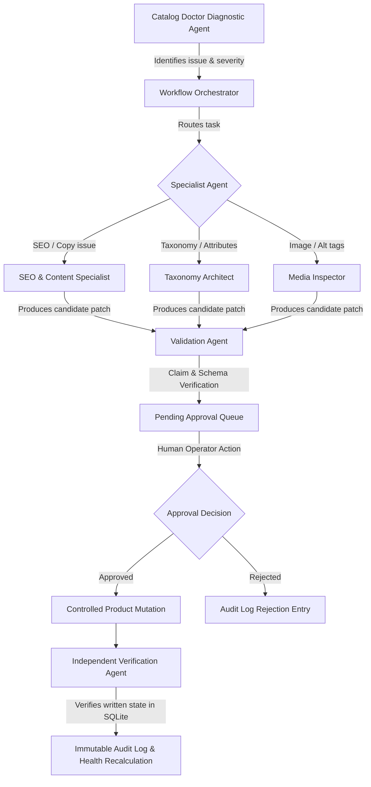

# CatalogPilot AI 🛸

> **Autonomous Catalog PIM, Quality Diagnostics & Multi-Agent Orchestration Platform**  
> *Built for the Kilowott AI Hackathon.*

[](https://www.typescriptlang.org/)
[](https://reactjs.org/)
[](https://vitejs.dev/)
[](https://expressjs.com/)
[](https://github.com/WiseLibs/better-sqlite3)
[](https://vitest.dev/)
[](https://ai.google.dev/)

---

## 📖 Executive Summary

E-commerce businesses frequently suffer from low conversion rates and search invisibility caused by messy catalog data: missing or thin descriptions, absent pricing, duplicate SKUs, missing images, unoptimized SEO metadata, and unstandardized attributes.

**CatalogPilot AI** transforms product catalog maintenance into a controlled, verifiable, and autonomous process. Rather than blindly letting an LLM mutate products, CatalogPilot enforces a strict 9-stage operational lifecycle:

```
CONNECT ➔ DISCOVER ➔ DIAGNOSE ➔ REASON ➔ PROPOSE ➔ VALIDATE ➔ APPROVE ➔ APPLY ➔ VERIFY
```

---

## 🌟 Key Features

- **🩺 Catalog Doctor (12 Diagnostic Rules)**: Deterministically evaluates products against 12 quality checks (missing descriptions, short copy, missing pricing, duplicate SKUs, missing images, missing alt tags, missing SEO titles/meta, uncategorized products, and empty attributes).
- **📊 Weighted Health Scoring (0–100)**: Evaluates description (25 pts), SEO (20 pts), media (20 pts), attributes (15 pts), SKU identifier (10 pts), and pricing (10 pts) with active issue penalties.
- **🤖 Multi-Agent Orchestrator**: Coordinates 4 specialized agents with typed structured inputs/outputs, state tracking, and failure boundaries:
  1. **Auditor Agent**: Evaluates diagnostic rules and isolates deficient fields.
  2. **Enrichment Agent**: Formulates schema-validated copy grounded in product specifications without hallucinating unverified claims.
  3. **Validation Agent**: Deterministically scans proposed copy for unsupported claims (FDA, CE, lifetime warranties, "#1 in the world") and enforces field length bounds.
  4. **Verification Agent**: Post-apply independent database auditor that reads persisted SQLite data directly from disk to confirm mutations match approved changes.
- **🛡️ Backend-Enforced Approval Gate**: AI proposals are strictly separated from mutations. Approvals are staged with side-by-side diff comparisons. The backend rejects attempts to approve non-pending proposals (`403 Forbidden`).
- **📜 Tamper-Evident Audit Trail**: Immutable log of every scan, proposal, approval decision, reviewer comment, and verification result.
- **⚡ Dual-Mode AI Provider**: Seamlessly supports live **Google Gemini 1.5** via `@google/generative-ai` with exponential backoff retries, or zero-config **Deterministic Demo Fixtures** when API keys are absent or `DEMO_MODE=true`.
- **🔄 WooCommerce Store Integration**: Built-in adapter with schema mapping, sync status, and simulated/live store modes.
- **💬 Context-Aware AI Copilot**: Global interactive drawer for catalog health inquiries and instant remediation triggers.
- **📁 CSV / JSON Ingestion & Export**: Robust multipart and JSON import with automatic diagnostics, plus instant catalog exports.

---

## 🏗️ Multi-Agent Architecture



---

## 📂 Monorepo Structure

```
killowot/
├── apps/
│   ├── api/                      # Express + TypeScript backend
│   │   ├── data/                 # SQLite database storage (excluded from git)
│   │   └── src/
│   │       ├── agents/           # 4 specialized agents & state orchestrator
│   │       ├── ai/               # Gemini provider & deterministic demo provider
│   │       ├── config/           # Environment & Winston structured logger
│   │       ├── database/         # SQLite schema migrations, seeds & reset
│   │       ├── middleware/       # Error handling & request logging
│   │       ├── routes/           # REST endpoints (products, doctor, agents, approvals...)
│   │       ├── services/         # Health scoring, diagnostic rules, product service
│   │       └── __tests__/        # Vitest unit & integration test suites
│   └── web/                      # React 18 + Vite frontend
│       └── src/
│           ├── api/              # Axios client connecting to backend
│           ├── components/       # Header, Sidebar, CopilotDrawer
│           └── pages/            # Dashboard, Products, CatalogDoctor, Agents, Approvals...
├── packages/
│   └── shared/                   # Shared Zod schemas & TypeScript types
├── package.json                  # Root npm-workspaces configuration
└── tsconfig.base.json            # Shared TypeScript configuration
```

---

## 🚀 Quick Start Guide

### Prerequisites
- **Node.js** >= 20.0.0
- **npm** >= 10.0.0
- **Windows / macOS / Linux**

### 1. Installation
Clone the repository and install all dependencies:
```bash
git clone https://github.com/abhishekpillai05/Kilowott-Hack-AI-Thon.git
cd Kilowott-Hack-AI-Thon
npm install
```

### 2. Environment Configuration
Copy the example environment file for the API:
```bash
cp apps/api/.env.example apps/api/.env
```

*(By default, `DEMO_MODE=true` is set. You do **not** need an API key to run or evaluate the full platform!)*

### 3. Initialize & Seed Database
Seed the SQLite database with rich catalog demo data:
```bash
npm run db:reset
```

### 4. Start the Application
Start both the backend API and frontend dev server concurrently:
```bash
npm run dev
```

- **Frontend Dashboard**: [http://localhost:5173/](http://localhost:5173/)
- **Backend Health Check**: [http://localhost:3001/health](http://localhost:3001/health)

---

## ⚙️ Environment Variables

Located in [`apps/api/.env`](file:///c:/Users/abhis/OneDrive/Desktop/killowot/apps/api/.env) (excluded from git):

| Variable | Default | Purpose |
| :--- | :--- | :--- |
| `PORT` | `3001` | Express backend port |
| `FRONTEND_URL` | `http://localhost:5173` | Allowed CORS origin |
| `DEMO_MODE` | `true` | When `true`, uses deterministic fixtures for 100% reliable judging |
| `GOOGLE_API_KEY` | *(optional)* | Google Gemini API key for live LLM requests |
| `GEMINI_MODEL` | `gemini-1.5-flash` | Gemini model identifier (`gemini-1.5-flash` or `gemini-1.5-pro`) |
| `WC_SITE_URL` | `https://demo-store.local` | WooCommerce site URL |
| `WC_CONSUMER_KEY` | *(optional)* | WooCommerce consumer key |
| `WC_CONSUMER_SECRET`| *(optional)* | WooCommerce consumer secret |

---

## 🧪 Testing & Quality Assurance

All 19 automated tests are verified and passing:

```bash
# Run unit & workflow test suite
npm test

# Run TypeScript typechecks across all 3 workspaces
npm run typecheck

# Build production bundles
npm run build
```

### Automated Test Suites:
1. **`healthScoring.test.ts`**: Verifies 100/100 scoring for optimized products, deficiency penalties, alt tag weighting, and categorization.
2. **`catalogDoctor.test.ts`**: Validates diagnostic rule checks for missing descriptions, missing pricing, duplicate SKUs, and missing alt tags.
3. **`api.test.ts`**: Tests `/health`, `/api/products`, `/api/products/dashboard`, and `/api/catalog-doctor/issues`.
4. **`workflow.test.ts`**: End-to-end integration test verifying product import → diagnostic scan → unsupported claims detection → approval gate enforcement → CSV/JSON export.

---


## 📡 REST API Reference

| Method | Endpoint | Description |
| :--- | :--- | :--- |
| `GET` | `/health` | System health check (database, AI mode, uptime) |
| `GET` | `/api/products` | Paginated product list with search and filters |
| `GET` | `/api/products/:id` | Single product details & metadata |
| `PATCH` | `/api/products/:id` | Direct product update with health score recalculation |
| `GET` | `/api/products/dashboard`| Aggregate catalog metrics and health score |
| `GET` | `/api/catalog-doctor/issues` | Active catalog diagnostic issues |
| `POST` | `/api/catalog-doctor/scan` | Trigger diagnostic scan on a single product |
| `POST` | `/api/catalog-doctor/scan-all` | Scan entire catalog for issues |
| `POST` | `/api/agents/run` | Dispatch multi-agent remediation workflow |
| `GET` | `/api/agents/runs` | List execution runs and task history |
| `GET` | `/api/approvals` | List pending, approved, or rejected proposals |
| `POST` | `/api/approvals/:id/approve` | Backend-enforced approval gate; triggers mutation & verification |
| `POST` | `/api/approvals/:id/reject` | Reject proposal with required reviewer reason |
| `POST` | `/api/copilot/chat` | Conversational assistant query |
| `POST` | `/api/import-export/import` | Ingest CSV or JSON catalog files |
| `GET` | `/api/import-export/export` | Export enriched catalog as CSV or JSON |
| `GET` | `/api/reports/audit-log` | Tamper-evident audit trail of catalog events |

---
